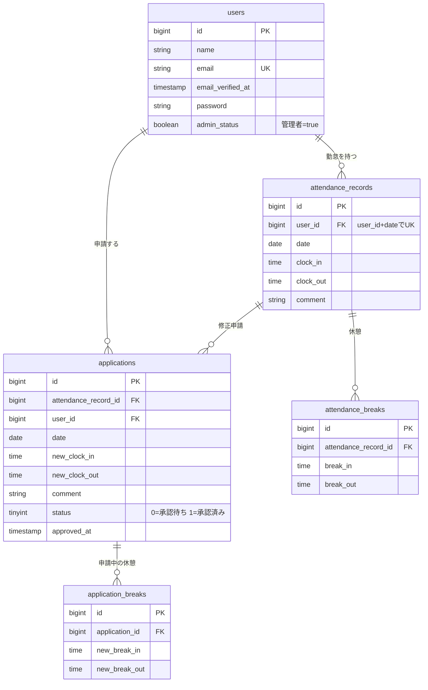

# coachtech 勤怠管理アプリ

一般ユーザーの出勤・休憩・退勤の打刻、勤怠の一覧・詳細、修正申請と、管理者による勤怠の確認・申請の承認ができる勤怠管理アプリです。

## 使用技術

| 区分           | 内容                                                                                                        |
| -------------- | ----------------------------------------------------------------------------------------------------------- |
| 言語           | PHP 8.2 以上（`composer.json` は `^8.1`。Sail のコンテナは `compose.yaml` の指定どおり PHP 8.5 で動きます） |
| フレームワーク | Laravel 10.x                                                                                                |
| 認証           | Laravel Fortify（会員登録・ログイン・メール認証） / Laravel Sanctum（公開 API の認証）                      |
| データベース   | MySQL 8.4                                                                                                   |
| 開発環境       | Laravel Sail（Docker）、Mailpit（メール確認）、phpMyAdmin                                                   |
| フロントエンド | Blade、Vite                                                                                                 |
| テスト         | PHPUnit 10（テスト用 DB は SQLite のインメモリ）                                                            |

## 環境構築

事前に Docker（Docker Desktop など）と Git をインストールしてください。

### 1. リポジトリを取得する

```bash
git clone https://github.com/Saito-N01/attendance-app.git
cd attendance-app
```

### 2. `.env.example` を `.env` にコピーします。

```bash
cp .env.example .env
```

| 項目            | 値         |
| --------------- | ---------- |
| `DB_CONNECTION` | `mysql`    |
| `DB_HOST`       | `mysql`    |
| `DB_PORT`       | `3306`     |
| `DB_DATABASE`   | `laravel`  |
| `DB_USERNAME`   | `sail`     |
| `DB_PASSWORD`   | `password` |
| `MAIL_MAILER`   | `smtp`     |
| `MAIL_HOST`     | `mailpit`  |
| `MAIL_PORT`     | `1025`     |

### 3. Composer のパッケージをインストールする

`vendor/` は Git に含まれないため、最初の 1 回だけ Docker で `composer install` を実行します（Sail を起動するために必要です）。

```bash
docker run --rm \
  -u "$(id -u):$(id -g)" \
  -v "$(pwd):/var/www/html" \
  -w /var/www/html \
  laravelsail/php82-composer:latest \
  composer install --ignore-platform-reqs
```

### 4. Sail を起動する

```bash
./vendor/bin/sail up -d
```

### 5. アプリケーションキーを生成する

```bash
./vendor/bin/sail artisan key:generate
```

### 6. マイグレーションとシーディングを実行する

```bash
./vendor/bin/sail artisan migrate --seed
```

ログイン用のユーザーと、サンプルの勤怠データが作成されます。

### 7. フロントエンドを起動する

```bash
./vendor/bin/sail npm install
./vendor/bin/sail npm run dev
```

`npm run dev` は起動したままにしてください（画面の CSS が読み込まれます）。

## URL

| 内容                        | URL                          |
| --------------------------- | ---------------------------- |
| アプリ（一般ユーザー）      | http://localhost/attendance  |
| 管理者ログイン              | http://localhost/admin/login |
| phpMyAdmin                  | http://localhost:8080        |
| Mailpit（受信メールの確認） | http://localhost:8025        |

## ログイン情報

シーディングで次のユーザーが作成されます。

| 区分         | メールアドレス      | パスワード |
| ------------ | ------------------- | ---------- |
| 管理者       | `user3@example.com` | `password` |
| 一般ユーザー | `user1@example.com` | `password` |
| 一般ユーザー | `user2@example.com` | `password` |

- 一般ユーザーは http://localhost/login、管理者は http://localhost/admin/login からログインします。
- 新規に会員登録したユーザーは、Mailpit（http://localhost:8025）に届く認証メールで認証を完了してください。

## API

外部のアプリケーションから勤怠データを取得・操作できる公開 API（JSON）です。ベース URL は `http://localhost/api/v1` です。

### エンドポイント一覧

| メソッド    | URI                               | 説明                                       | 認証                     |
| ----------- | --------------------------------- | ------------------------------------------ | ------------------------ |
| GET         | `/api/v1/attendance-records`      | 勤怠一覧（絞り込み・ページネーション対応） | 不要                     |
| GET         | `/api/v1/attendance-records/{id}` | 勤怠詳細（ユーザー・休憩・修正申請を含む） | 不要                     |
| POST        | `/api/v1/attendance-records`      | 勤怠の新規登録                             | 必要                     |
| PUT / PATCH | `/api/v1/attendance-records/{id}` | 勤怠の更新（送った項目だけ更新）           | 必要（本人または管理者） |
| DELETE      | `/api/v1/attendance-records/{id}` | 勤怠の削除（休憩・修正申請も一緒に削除）   | 必要（本人または管理者） |

- 読み取り（GET）は認証なしで呼べます。書き込み（POST / PUT / PATCH / DELETE）は Laravel Sanctum のトークンが必要です。
- 更新・削除は、勤怠の持ち主本人か管理者だけが行えます。
- リクエストには `Accept: application/json` を付けてください。

## ER 図



- 主要なテーブルのみを示しています（`created_at` / `updated_at` と、`password_reset_tokens` / `failed_jobs` / `personal_access_tokens` などの Laravel 標準テーブルは省略）。

## テストの実行

```bash
./vendor/bin/sail artisan test
```

テストは SQLite のインメモリ DB で実行するため、開発用の MySQL のデータには影響しません。

## 作成者

斎藤 直人
